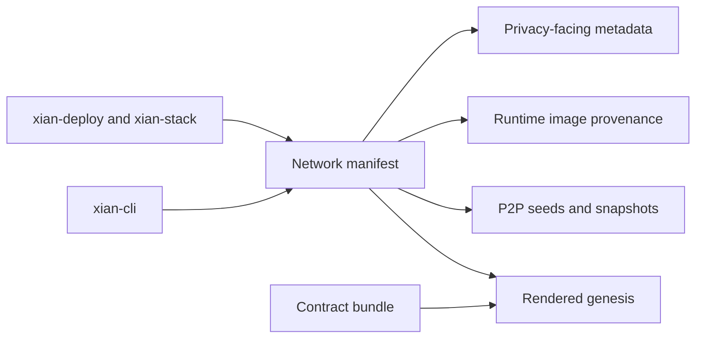

# Network Bundles

## Purpose
- This folder contains canonical bundle manifests used to build deterministic
  test and development networks.

## Contents
- one directory per supported genesis bundle
- manifest data only; genesis is rendered from the bundle's contract bundle

## Notes
- Keep bundle-owned data here, not in `xian-abci` or `xian-cli`.
- Bundle genesis is rendered from the matching contract bundle under
  `contracts/contracts_<bundle>.json`.
- Validator policy for active bundles is pinned explicitly in those bundles so
  the bundle behavior does not depend on hidden contract defaults.
- Every manifest pins its chain `fee_policy` in canonical form (`tx_fee_mode`,
  `max_tx_chi`, `max_block_chi`). The chi caps bound how long one transaction
  and one block can execute in every fee mode, so they are a network decision,
  not a node default. `scripts/validate-manifests.py` rejects a manifest
  without them.
- `genesis_sha256` pins a network's genesis: the SHA-256 of the exact
  `config/genesis.json` bytes `xian node init` installs (canonical encoding,
  so `sha256sum <home>/config/genesis.json` on any node prints it). When it is
  set, `node init`, `network join --init-node` and the operator bundle refuse
  any other genesis, and `scripts/validate-manifests.py` rebuilds the bundle
  genesis and rejects a stale pin. Pin it once a network's genesis is fixed;
  the `local` bundle, which follows the current contracts, leaves it unset. A draft `mainnet` must list pinning it
  under `genesis_build.finalization_required`; once `genesis_build.status` is no
  longer `draft-rehearsal`, the validator requires the pin.
- The canonical `mainnet` bundle is an explicit draft rehearsal. It uses `local_build` and pin the unmodified CometBFT 0.40.0 source commit
  and archive checksum in their intended build recipes. They carry no registry
  image digests until matching images are published and accepted. The recipe is
  build intent, not an attestation of a previously published image. Finalization
  must refresh all component/build inputs and pin both immutable image digests;
  the validator requires registry images once the draft status is removed.
- A release recipe cannot name its own containing Git commit. A metadata-only
  follow-up can pin the preceding source commit after proving its contract and
  code trees are unchanged. The complete image build manifest is authoritative
  for build inputs; a packaged operator manifest preserves normalized recipe
  fields and does not independently attest the complete toolchain recipe.
- The `local` bundle serves the single-node dev node and multi-node
  localnets (including the 5-validator end-to-end and protocol-safety runs,
  whose genesis sets the localnet's own validators and founder).
- The canonical `mainnet` bundle is a draft rehearsal manifest for
  `xian-mainnet-1`. It derives genesis from `contracts_mainnet.json`, starts
  from one bootstrap validator, enables the chain `zk` runtime feature, and must
  have its allocation, seed, image pins, and release manifest refreshed before a
  final launch tag.
- Networks can also pin privacy-facing metadata here:
  - `privacy_artifact_catalog`: a checksum-pinned catalog of approved shielded
    registry manifests for that network
  - `shielded_history_policy`: the network's compatibility and retention
    commitment for `shielded_wallet_history`
  - `privacy_submission_policy`: operator-facing policy for relayer auth and
    hidden-sender submission posture

